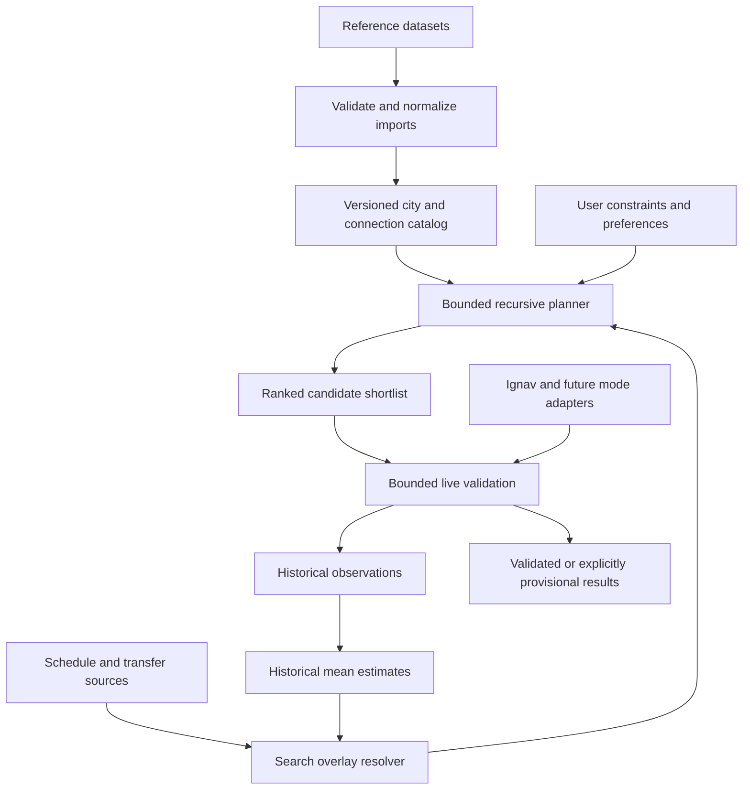

# Integrating the round-trip algorithm

Status: implementation design only; no application behavior is changed. This document translates [ALGORITHM.md](ALGORITHM.md) into application responsibilities and delivery steps, within the foundation described in [PLAN.md](PLAN.md). Proposed module names and contracts below do not yet exist unless explicitly identified as existing.

## 1. Architecture: static topology with contextual overlays

Build a reusable, versioned city-connection graph from reference datasets. Resolve fares, schedules, travel durations, transfers, and availability through separate overlays when a search needs them. Keep user preferences in the search request rather than writing personalized weights into the shared graph.

The static graph answers **which connections are known to exist**. An overlay answers **what is known about a connection for this traveler and travel window**. Neither static connectivity nor a historical average establishes current availability.

“Static” means relatively stable and published as a snapshot, not permanently accurate. Routes open, close, and operate seasonally. Snapshots need provenance, validity information, refreshes, and retirement rules.

The planner reads an immutable topology snapshot and a stable estimate snapshot. Live validation produces a new revision of a candidate; it does not overwrite the graph's global weights or alter sibling search branches.

## 2. Fit with the existing repository

| Existing location | Current responsibility | Integration approach |
| --- | --- | --- |
| `backend/src/backend/domain/` | Travel modes and normalized flight fares | Add provider-independent catalog, overlay, search-state, and result concepts |
| `backend/src/backend/application/ports.py` | Graph-writing boundary for supplied fares | Add narrow read/write boundaries for catalog, estimates, schedules, and provider validation; preserve the existing projection boundary |
| `backend/src/backend/application/fare_graph.py` | Project supplied fare searches | Keep this projection; add separate round-trip orchestration and recursive exploration |
| `backend/src/backend/infrastructure/graphs/weighted_graph.py` | Directed multigraph requiring cost and duration on travel edges | Retain for fully weighted projections and tests; do not populate unknown costs or durations with zero to reuse it as the catalog |
| `backend/src/backend/infrastructure/ignav/fare_search.py` | Normalize supplied Ignav responses | Reuse behind a future live provider adapter |
| `backend/src/backend/infrastructure/ignav/graph.py` | Airport/segment graph with complete itinerary prices | Retain as a diagnostic projection; its segment edges are not independently purchasable fare edges |
| `backend/src/backend/infrastructure/fixtures/` | Synthetic networks and external reference-data downloader | Use deterministic fixtures for the first slice; introduce production catalog import responsibilities separately |
| `backend/src/backend/infrastructure/fixtures/download_mobilitydatabase.py`, `combine_mobilitydatabase.py` | Download European GTFS snapshots and extract filtered scheduling tables into checkpointed DuckDB | Reuse acquisition artifacts; add feed acceptance and semantic GTFS normalization before routing |
| `backend/src/backend/infrastructure/catalog/base_graph.py` | Unweighted reference city graph from local city/airline snapshots | Extend through catalog boundaries with accepted GTFS connection evidence; current reference edges are not live-search eligible |
| `shared/graphql/schema_v1.graphql` | Shared input/output contract | Evolve source contracts to express duration, estimates, coverage, and validation state, then regenerate consumers |
| `frontend/app/page.tsx` | Hardcoded city list and delayed sample results | Replace with catalog lookup and the application search flow during implementation |
| `frontend/components/trip-inputs.tsx`, `trip-opportunities.tsx` | Input and result compositions | Extend existing components to display constraints, provisional results, and source coverage |

The repository has no implemented historical-price store, timed round-trip solver, live Ignav HTTP client, or running search API. Generated GraphQL models alone do not provide an executable server. Those are delivery tasks, not existing capabilities.

Keep the current inward dependency direction: presentation and infrastructure depend on application/domain contracts. The core must remain importable without third-party packages, as required by the existing architecture tests. Graph-library and database objects belong in adapters.

## 3. Constructing the static graph

### 3.1 Separate places from connectivity

Use three distinct reference-data products:

1. **City catalog:** canonical city IDs, names/aliases, country, representative coordinates, timezone, and source mappings.
2. **Terminal catalog:** airports, rail stations, bus stations, and ferry ports; coordinates, timezone, operator/source identifiers, and reviewed city associations.
3. **Connection catalog:** directed transport connections between terminals, projected into city-to-city adjacency for exploration.

A city list supplies nodes. A station list supplies terminals. Neither proves that two cities have a direct train, bus, flight, or ferry service. Geographic proximity, a railway line, or two airports must not automatically create a real passenger-service edge.

For topology, accept documented route listings, operator service catalogs, or observed service patterns from a dated schedule source. Preserve the difference between an established route, a historical route, and a hypothetical connection. Exclude hypothetical edges from ordinary live searches; they may be useful in an explicitly synthetic demonstration.

### 3.2 Existing dataset entry points

The downloader in `infrastructure/fixtures/download_datasets.py` currently configures three external datasets under the names `cities`, `train-stations`, and `airlines`. Treat these as candidate inputs for inspection, not approved production sources. The checked-in downloader does not establish their current contents, geographic coverage, licenses, accuracy, or suitability for live routing.

Before accepting any source, record its actual fields, stable IDs, publication date, coverage, commercial-use/storage rights, attribution, and refresh mechanism. In particular, determine whether the airline dataset describes routes, dated services, or historical fare samples; those belong to different parts of this design.

Use Mobility Database as the planned discovery and snapshot source for available bus, rail, and ferry GTFS Schedule feeds, subject to per-feed acceptance. This selects an acquisition path, not universal operator coverage or a fare/inventory provider. Detailed requirements follow in section 3.5. No new download is required by this documentation change.

### 3.3 Identity and connection granularity

Give cities and terminals internal stable IDs, with provider codes as aliases. Do not use a display name or airport code as a universal city identifier. A city may have multiple terminals, and a terminal's marketing city may differ from its physical municipality. Ambiguous mappings require review rather than nearest-city assignment without evidence.

Each connection should retain:

| Field group | Purpose |
| --- | --- |
| Connection ID and source mapping | Stable overlay joins and deduplication |
| Origin/destination city and terminal IDs | City exploration plus terminal-level feasibility |
| Mode, operator/service-pattern identity when known | Preserve meaningful parallel alternatives |
| Source and source record ID | Traceability and reconciliation |
| Dataset version, observation/publication time, validity dates | Establish the evidence and period behind the edge |
| Coverage/status | Distinguish supported, historical, retired, and synthetic data |

Store direction explicitly. A connection from A to B does not imply the reverse. Distinct modes and terminal pairs between the same cities remain parallel alternatives. Multiple source records describing the same service should map to one canonical connection with multiple provenance records where identity is established; do not merge solely because city endpoints match.

Keep physical service segments distinct from purchasable journeys. A one-way flight offer from A through B to C can form one atomic purchase A→C, with its internal segments retained for timing, excluded-city checks, and transfers. It does not establish a direct A→C physical service.

### 3.4 Import and publication lifecycle

Use an offline ingestion workflow:

1. Save an immutable raw source snapshot with checksum and a manifest of retrieval time, source version, rights, and coverage.
2. Parse into staging records; normalize modes, units, identifiers, coordinates, and timezones.
3. Resolve source identifiers to canonical cities/terminals; quarantine ambiguous or invalid records.
4. Validate endpoint references, direction, uniqueness, validity intervals, and provenance. Report isolated cities and missing reverse routes without inventing edges to repair them.
5. Produce canonical records and outgoing/incoming adjacency indexes.
6. Compare against the previous version; review unexpectedly large losses, merges, or geographic changes.
7. Publish the snapshot atomically. Retain the previous version for rollback and active searches.

Imports must be repeatable: identical source bytes and mapping rules produce identical records and stable identities. Keep checked-in fixtures small; store bulk raw datasets outside source control according to their licenses.

### 3.5 Mobility Database: exact data requirements

The local [Mobility Database OpenAPI contract](docs/api_references/mobilitydatabase/openapi.yml) is the API reference for this integration. Its `GtfsFeed`, `LatestDataset`, `GtfsDataset`, `SourceInfo`, and parameter definitions describe catalog metadata and downloadable archives. GTFS table semantics come from the separate [official GTFS Schedule reference](https://gtfs.org/documentation/schedule/reference/); the OpenAPI file does not define the CSV tables inside a ZIP.

#### Acquisition scope and API operations

| Priority | Operation in the local contract | Data/use |
| --- | --- | --- |
| Required | `GET /v1/gtfs_feeds` | Paginated GTFS Schedule discovery; select geography with `country_code` and/or bounding coordinates; deduplicate by feed ID |
| Required | `GET /v1/gtfs_feeds/{id}` | Feed detail, status, provenance, redirects and latest snapshot metadata |
| Required when detail is needed | `GET /v1/datasets/gtfs/{id}` | Metadata for a pinned dataset ID; retrieve the archive from its `hosted_url` |
| Required for coverage gaps/version selection | `GET /v1/gtfs_feeds/{id}/datasets` | Available versions; use `latest`, pagination and download-time filters as applicable, then check actual service coverage |
| Conditional | `GET /v1/licenses/{id}` | License details/rules for `source_info.license_id`; retain and review publisher terms as well |
| Useful, later | `GET /v1/gtfs_feeds/{id}/continuous_coverage`, `/validation_reports`, `/reliability`, `/availability` | Import diagnostics; some endpoints are beta. Feed HTTP availability is not seat availability or schedule validity |
| Optional, later | `GET /v1/gtfs_feeds/{id}/gtfs_rt_feeds` and `GET /v1/gtfs_rt_feeds/{id}` | Discover linked realtime sources for disruptions after static routing works |
| Optional | `GET /v1/locations`, `GET /v1/search` | Administrative discovery and manual investigation; not the application's canonical city/terminal lookup |
| Out of initial scope | GBFS endpoints | Shared-mobility data, outside the selected plane/bus/train/ferry planning scope |

Country filters match catalog locations, not necessarily every stop in a cross-border trip. For bounded geographic discovery, provide both `dataset_latitudes` and `dataset_longitudes` and explicitly choose `bounding_filter_method=partially_enclosed` when intersecting feeds are wanted; the default is complete enclosure. Verify actual stop coverage after download. There is no documented transport-mode filter on `/v1/gtfs_feeds`; classify individual routes inside the archive rather than assuming every route in a feed is a bus or train.

Prefer official feeds, but record their actual status and acceptance decision. Publish active, licensed, validated feeds with service covering the requested window. Quarantine deprecated/development feeds; stage future feeds and explicitly review inactive feeds. Follow `redirects[].target_id` with cycle detection and deduplication, keeping the original lineage. Seasonal service is valid only on its operating dates.

Paginate within endpoint-specific limits and deduplicate results. The current downloader scans the catalog, selects broad European feed locations, and downloads latest datasets for **all statuses**. That is acquisition behavior, not an acceptance policy. Its Europe allowlist also differs from the city base graph's country scope; resolve one explicit launch scope before combining them.

The contract describes bearer authentication and one-hour access tokens. Keep credentials server-side. The existing downloader exchanges refresh tokens at `/v1/tokens`, but that operation is absent from this checked-in OpenAPI `paths` section; verify its separate authentication contract before treating it as documented here. Hosted dataset URLs are described as requiring no authentication: do not forward catalog credentials to archive hosts.

#### Catalog and dataset fields to retain

| Record | Minimum retained fields | Reason |
| --- | --- | --- |
| Feed identity | `id`, `data_type`, `provider`, `feed_name`, `external_ids` when present | Stable feed namespace, attribution and duplicate-source reconciliation |
| Feed acceptance | `status`, `official`, `official_updated_at`, `seasonal`, `note`, `redirects`, relevant `related_links` | Explicit eligibility, replacement and future/seasonal context |
| Geography | `locations`, feed/dataset `bounding_box` | Discovery and coverage diagnostics; not city IDs or proof of terminal membership |
| Source/access | `source_info.producer_url`, `is_producer_url_unstable`, `authentication_type`, `authentication_info_url`, `api_key_parameter_name` | Source traceability and safe future refresh; never persist credential values in these records |
| Rights | `source_info.license_url`, `license_id`, `license_is_spdx`, `license_notes`, `license_tags` where supplied | Per-feed rights review; the API specification's license does not license every underlying feed |
| Snapshot identity | `latest_dataset.id` or dataset `id`, dataset `feed_id`, `hosted_url`, `downloaded_at`, `hash` | Pin bytes/version and verify SHA-256; also retain local retrieval time and computed checksum |
| Snapshot suitability | `service_date_range_start`, `service_date_range_end`, `agency_timezone`, `validation_report`, `zipped_folder_size_mb`, `unzipped_folder_size_mb` where present | Initial date/quality/size screening, followed by semantic validation of archive contents |

Many contract properties are optional: preserve missing values and require the evidence needed for each acceptance decision rather than assuming complete metadata. `downloaded_at` is the catalog's producer-download time, not the service date or our retrieval time. Date ranges are screening hints; they do not prove service operates every day. The local contract describes different polling cadences on feed detail and dataset-history operations, so do not promise a single freshness SLA from those descriptions.

#### GTFS Schedule files to ingest

Download the accepted archive as a versioned artifact, but normalize only the tables needed by a supported capability. Preserve other files for future import rather than loading every file into the planner. The minimum scheduling core is `agency.txt`, `stops.txt`, `routes.txt`, `trips.txt`, `stop_times.txt`, plus a valid calendar representation; `calendar.txt` may be omitted when `calendar_dates.txt` enumerates all service dates.

| Capability | Files and fields to retain | Destination |
| --- | --- | --- |
| Operator/timezone | `agency.txt`: `agency_id`, `agency_name`, `agency_timezone`, `agency_url` | Operator identity, attribution and service-time interpretation |
| Terminals | `stops.txt`: `stop_id`, `stop_name`, `stop_lat`, `stop_lon`, `location_type`, `parent_station`, `stop_timezone`, `zone_id`, accessibility fields when present | Station/platform hierarchy and reviewed mapping to existing canonical cities |
| Routes/modes | `routes.txt`: `route_id`, `agency_id`, `route_type`, route names and URL; `network_id` when used by fares | Mode/operator/service pattern and display metadata |
| Trips | `trips.txt`: `trip_id`, `route_id`, `service_id`, `direction_id`, `block_id`, `shape_id` and accessibility fields when supplied | Trip-pattern identity and links; direction is derived from stop order, not `direction_id` alone |
| Ordered movement | `stop_times.txt`: `trip_id`, `stop_id`, `stop_sequence`, `arrival_time`, `departure_time`, `pickup_type`, `drop_off_type`, `timepoint`; preserve other boarding/window restrictions when present | Ordered terminal movements, permitted boarding/alighting, and scheduled duration |
| Operating days | `calendar.txt`: `service_id`, weekday flags, `start_date`, `end_date`; `calendar_dates.txt`: `service_id`, `date`, `exception_type` | Actual dated departures, including added/removed service |
| Frequency service, conditional | `frequencies.txt`: `trip_id`, `start_time`, `end_time`, `headway_secs`, `exact_times` | Frequency windows; do not fabricate exact departures for non-exact service |
| Transfers, conditional | `transfers.txt`: applicable stop/route/trip keys, `transfer_type`, `min_transfer_time`; `pathways.txt` and `levels.txt` when supplied | Explicit station movement and transfer restrictions; absent rules do not imply instant transfers |
| Feed context, when present | `feed_info.txt`: publisher, version, language and validity fields | Additional provenance and declared coverage |
| Optional map geometry | `shapes.txt` | Route drawing only; not required to discover adjacency or compute elapsed time |

Map basic `route_type` 2→`TRAINS`, 3→`BUSSES`, 4→ferry support after the enum migration. Handle extended route types through a reviewed mapping table. Keep urban access modes separate from intercity exploration policy; unsupported types remain explicitly unsupported. GTFS is the planned ground/water feed path, while flight availability remains with Ignav.

Namespace every raw ID by feed and dataset version. IDs such as `stop_id`, `route_id`, and `trip_id` are not globally unique, and must not automatically become permanent application IDs. Reconcile across versions and overlapping regional/national feeds with source mappings. Catalog `municipality` labels and stop names do not establish canonical city identity; use coordinates, station hierarchy, reviewed geographic boundaries/mappings and explicit overrides.

#### Deriving graph edges and schedule overlays

1. Join routes→trips→ordered stop times. Resolve stops to platform/station identities and canonical cities, preserving unresolved mappings as import issues.
2. Keep consecutive terminal movements as physical topology. For city exploration, derive reachable boarding/alighting city pairs on the **same trip** in increasing stop order, retaining intermediate stops and boarding restrictions. Generate these journey options on demand or by indexed trip patterns to avoid materializing all stop pairs across large feeds.
3. Do not join arbitrary stops sharing `route_id`: branches and variants can serve different stop sequences. A same-vehicle A→B→C journey may be explored as A→C while preserving B internally; B is not a required sightseeing visit, but still matters for excluded-city checks. If intermediate city mappings are unresolved, excluded-city compliance remains incomplete.
4. Build dated service overlays by applying regular calendars and exceptions for the search horizon. Derive movement/ride durations from departure at the boarding stop and arrival at the alighting stop, with intermediate dwell included. Do not replace them with geographic distance or a feed-wide average.
5. Apply GTFS service-day time semantics, including values after `24:00:00`, agency timezone and DST behavior. Do not parse all times as ordinary same-day clock values or reinterpret stop times independently in each stop's timezone. Preserve service-date identity alongside UTC instants; test overnight and DST boundaries against the specification.
6. Treat missing/interpolated times, non-exact frequencies and on-demand booking windows as separate capabilities. Preserve their evidence, but defer them or emit provisional timing until an appropriate model exists; never advertise an invented exact schedule.
7. Add explicit transfer/access overlays between trips and terminals. A shared city label is insufficient for a feasible connection. Shared `block_id` alone does not authorize staying aboard or imply a through-ticket.
8. Publish topology and schedules under the same import lineage, while retaining separate graph and overlay records. Search reads pinned versions; a refresh does not change active branch states.

#### Fare data: useful when present, optional for the first import

GTFS fares are optional. Retain V1 `fare_attributes.txt` and `fare_rules.txt` when present. For V2, retain `fare_products.txt`, `fare_leg_rules.txt`, `fare_transfer_rules.txt` and their referenced media, rider-category, area, network, timeframe and join-rule tables when supplied. Import a complete supported rule set rather than copying a product price onto every route edge. Both fare generations may coexist; follow the specification's precedence and capability rules. See the [official fare reference](https://gtfs.org/documentation/schedule/reference/#fare_productstxt).

Initially, fare-rule evaluation may remain unsupported: retain the source files, report `fare rules present / not evaluated`, and use comparable real historical quotes or unknown prices for the mean-estimate overlay. Later add a dedicated tariff resolver. Published tariff evidence is distinct from a provider quote and must not be inserted as another historical quote sample on every import. Transfer discounts, zones, rider eligibility, required media and extra reservations can make per-edge addition incorrect.

Even an evaluated GTFS tariff does not establish ticket inventory, reservation availability, a booking link, or a current dynamic intercity fare. Missing tariff data means unknown, never free. Commercial priced-offer sources for bus/train/ferry therefore remain an open workstream.

#### Repository artifacts and first deliverable

Reuse the current `catalog.json`, `manifest.json` and downloaded ZIPs under `backend/src/backend/infrastructure/fixtures/data/mobilitydatabase/`. The extractor now writes selected bus/rail/ferry scheduling tables to `schedules.duckdb`, with feed-scoped VARCHAR identifiers and per-feed checkpoints in `schedules.staging.duckdb`. Shapes, bike attributes and unrelated files are skipped; fares/pathways are deferred. This is filtered staging data, not a validated timetable or city graph. Join archive paths back to feed/dataset metadata through the manifest and query relevant rows rather than loading all feeds into a search.

The current downloader writes one `raw/{feed_id}.zip` per feed, so future downloads can replace its previous bytes. Production ingestion must retain accepted snapshots under immutable feed/dataset/checksum identities before relying on reproducibility. Retain originals and metadata; a combined file alone does not preserve the acquisition/rights lineage.

First deliverable: one reviewed corridor with accepted feeds, mapped terminals, directed city adjacency, and calendar-correct schedule queries for a fixed window. Include an import report with feed/dataset IDs, modes, covered cities/dates, unknown mappings, unsupported features, rights decisions and fare availability. An absent catalog route is a coverage gap, not proof that no operator serves it.

Acceptance tests must include feed-local ID collisions, duplicate cross-border feeds, calendar-only and exception-only calendars, removed holiday service, overnight/DST times, non-exact frequencies, prohibited pickup/drop-off, route variants, station transfers, redirect cycles, replaced snapshots, unknown fares and out-of-horizon schedules. Use small offline archives; no live credentials are needed for ordinary tests.

## 4. Overlay design

An overlay is contextual evidence attached to a connection, service, transfer, or purchase unit. It is not a single mutable dictionary of edge weights. Different overlay types have different identities and expiration rules.

| Overlay | Key/context | Contents and interpretation |
| --- | --- | --- |
| Historical fare estimate | Directed purchase scope, mode, terminals where relevant, currency, traveler/fare inclusions, estimator version and cutoff | Arithmetic mean, sample count, observation range, uncertainty; no current availability claim |
| Approximate duration | Connection/service pattern, context and model version | Expected movement duration and evidence; useful for provisional exploration, not a proven lower bound |
| Schedule | Service identity, operating date, terminal pair and source version | Actual planned departure/arrival instants and calendar exceptions; a timetable alone does not guarantee seats |
| Transfer/access | Terminal pair or city access point, mode, time/context | Walking/access time, processing requirements, terminal changes, cost if applicable, and evidence |
| Live offer | Provider, exact request context, offer/purchase identity and observation time | Dated segments, total fare, inclusions, availability status, expiry where supplied, and booking eligibility |
| Disruption | Affected service/terminal, effective period and source | Cancellation or changed schedule; invalidates conflicting candidate assumptions |

Attach source, freshness, validity, and synthetic/real provenance to every overlay. Do not infer universal freshness durations: configure them per source and evidence type after provider terms and update behavior are checked.

### 4.1 Resolving overlays for a search

The resolver receives a connection or journey scope plus the requested dates, traveler basis, currency, and search snapshot. It returns evidence and explicit missing-data states.

- Prefer an eligible, fresh exact-context offer over a historical price estimate for that purchase unit. Keep both values for comparison; do not overwrite the history.
- Use applicable schedules for timing. Reconcile conflicts by explicit source/version rules and surface unresolved conflicts.
- Use approximate durations only for provisional route exploration when schedules are absent.
- Preserve `unknown`, `expired`, `unsupported`, `unavailable for this request`, and `provider failed` as different states.
- Never substitute zero for unknown cost, duration, access time, or connection time.
- Exclude synthetic observations from real searches and real aggregates by enforced provenance filters.

An edge can exist without a price or schedule overlay. Missing overlays do not remove it from the catalog. Conversely, an old topology edge does not guarantee a current service. A fresh provider discovery can be retained as search-local evidence and proposed for a later catalog publication without silently mutating the snapshot under an ongoing search.

### 4.2 Monetary and temporal invariants

Use exact decimal monetary values and an explicit currency through storage and serialization. The existing `domain/fares.py` represents amounts as floats; decimal handling is a planned migration across the ingestion boundary, domain models, serialization, and tests. Conversion after float rounding cannot restore lost precision.

Start with comparable observations in the requested currency. Unsupported conversion must be reported; do not average different currencies or assume equivalent prices. Currency conversion can be added with its own dated rate evidence later.

Historical observations describe independently purchasable units. Count a multi-segment one-way offer once. Keep a bundled return fare separate from its individual directions and never split it into fabricated segment fares. The first general multi-city solver should combine independent one-way purchase units; use whole round-trip offers only through a separate compatible candidate path until coupled-purchase state is implemented.

Store aware instants for scheduled movement and preserve local timezone/service-date context. Use seconds for internal elapsed durations. Convert the existing Ignav duration-in-minutes representation at the adapter boundary. Count waiting, transfers, initial waiting, and visits toward the fixed maximum-duration deadline defined in `ALGORITHM.md`.

## 5. Storage and read models

Separate authoritative records from derived graph indexes. A graph database is not required by this design. Database-engine selection remains open until deployment, concurrency, migration, backup, and retention needs are established; the presence of DuckDB in the dependencies is not a production-store decision.

The proposed logical records are:

| Records | Role |
| --- | --- |
| Dataset versions, source records, identity mappings | Reproducible imports and stable joins |
| Cities, terminals, connection definitions and evidence | Static catalog snapshots |
| Service instances and transfer rules | Date-aware feasibility |
| Fare observations and purchase segments | Immutable price history with complete purchase scope |
| Estimate aggregates | Derived mean, count, sum, context and estimator version |
| Cached provider responses/offers | Eligible reuse under provider terms |
| Search metadata and optional result revisions | Reproducibility and bounded operational diagnostics |

For observations, retain travel date, observed-at and ingested-at timestamps, provider, exact search context, currency, inclusions, and source quote identity. A cache reread must not become a new sample. Deduplication should use provider quote identity and observation semantics when reliable, with a normalized response fingerprint fallback; a provider may reuse an offer ID across genuine later price changes.

Keep the arithmetic mean from `ALGORITHM.md` as the baseline. Version the comparability and sampling policy so changes do not silently reinterpret historical averages. Preserve source observations to recompute aggregates. Missing samples produce an unknown estimate, not a mean of zero.

Build indexes around actual access patterns: outgoing connections by city/mode/version, departures by terminal and time range, and historical aggregates by comparable purchase context. Load adjacency once per catalog version and batch/cache estimate reads across a search. Do not issue a database query and network call at every recursive expansion.

## 6. Backend responsibilities

Proposed responsibilities fit within the current canonical packages:

| Layer | Proposed responsibility |
| --- | --- |
| `domain/catalog.py` | City, terminal, connection and source identity concepts |
| `domain/planning.py` | Constraints, immutable branch state, visit accounting, feasibility rules and candidate outcomes |
| `domain/estimates.py` | Comparable-price context, estimate evidence and unknown values |
| `application/round_trip_search.py` | Execute the normalized request, exploration, shortlist and result assembly |
| `application/overlay_resolution.py` | Join topology with contextual evidence through ports |
| `application/price_estimation.py` | Historical aggregation policy and estimate snapshot selection |
| `application/validation.py` | Bounded provider validation and complete candidate re-evaluation |
| `application/ports.py` | Catalog, schedule, history, provider, cache and clock boundaries |
| `infrastructure/catalog/`, `infrastructure/persistence/` | Importers, repositories, publication and migrations |
| `infrastructure/graphs/` | Graph projections and adjacency/index adapters |
| `infrastructure/ignav/` | Live request handling around existing response normalization |
| `presentation/` | API/CLI validation, serialization and dependency assembly |

These names are a proposed allocation, not a requirement to create every file immediately. Add boundaries when the first working slice needs them. Keep provider-specific identifiers and payloads outside the recursive solver.

Required port capabilities include outgoing catalog lookup, bounded departure lookup, transfer resolution, batch estimate retrieval, exact-context offer retrieval, and deduplicated observation recording. Mode adapters should declare capabilities and coverage; do not force a schedule-only source to pretend it can return fares or booking links.

## 7. End-to-end search integration

1. **Normalize input.** Resolve canonical home city, permitted modes, excluded/mandatory cities, timezone-aware departure, maximum elapsed duration, stays, and optional budget/return window. Validate coverage and conflicting inputs.
2. **Pin a snapshot.** Record catalog version, schedule versions, historical-data cutoff, estimator version, and policy version. Compute the fixed deadline from earliest departure plus maximum duration.
3. **Prepare read models.** Load selected-mode adjacency and relevant overlay indexes. Compute directed reachability home within the catalog. Only use proven optimistic duration bounds for definitive pruning.
4. **Explore recursively.** Read outgoing connections; resolve dated service or provisional duration alternatives; attach historical means; produce independent branch states. Track terminal, current time, visits, purchase units, known-price subtotal, and unknown evidence.
5. **Apply bounds.** Enforce actual schedule feasibility where known, visits, allowed/excluded cities including internal connections, and deadline. Apply explicit state/leg/runtime limits. Typical durations and average prices may guide order but must not establish impossibility.
6. **Collect return candidates.** Require a non-home visit and required stays; end a branch on its first return home as specified in `ALGORITHM.md`. Retain uncertainty and data provenance.
7. **Shortlist.** Deduplicate equivalent service/purchase combinations and rank with the selected preferences. Reserve a bounded share for unknown-price candidates and route diversity.
8. **Validate live.** Retrieve eligible cached quotes or call providers for shortlisted purchase units. Share identical requests across candidates. Rebuild schedules, transfers, visits and totals from returned offers, then recheck all constraints.
9. **Recover within limits.** If a service is unavailable or changes timing, try another candidate or bounded local re-search. Charge retries and repair searches against the same request budget and deadline; prevent unlimited validation loops.
10. **Return results.** Distinguish provisional candidates from fully priced, schedule-feasible quoted itineraries. Record observations for subsequent estimate snapshots, without changing the current search's historical mean midway through traversal.

When timing is approximate, an estimated deadline violation may exclude a route only in an explicitly approximate search policy. A missing schedule does not justify a definitive “no trip exists” result. If there is no timing estimate either, keep the connection in an unresolved-data pool for bounded enrichment; do not recurse through it as a zero-duration movement.

Duration alone is not a practical complexity limit. Require positive time advancement, finite departure alternatives, and explicit bounds. A recursive specification can later use an explicit work stack to avoid dependence on language recursion limits while preserving branch behavior.

### Preferences as a final, request-local overlay

Keep physical prices and times unchanged. Derive a ranking score from normalized price, travel burden and other approved preferences per request, recording the normalization policy. Increasing a price/time weight changes traversal or ranking, not service facts or hard feasibility rules.

Preserve existing v1 meanings: `expenses_tolerance` is an absolute budget, and `time_tolerance` is return-arrival deviation in minutes. Neither is the maximum trip duration or a ranking coefficient. The v1 ordering is price first, then travel time; weighted ordering needs an explicit evolved contract.

## 8. Provider integration and paid-request controls

For Ignav, wrap the existing normalized fare mapping with request construction, authentication, timeout handling, errors, cache eligibility and observation persistence. Use the checked-in OpenAPI reference as the local contract input; verify deployed capabilities and commercial rules before live integration. Do not assume Ignav exposes a complete route-catalog endpoint.

Do not call live fare search for every static edge. The normal expansion path uses catalog, schedule and historical data. Missing schedule acquisition may itself cost money and must be included in request accounting.

Use request keys containing provider, terminals, dates, travelers, fare preferences, currency/market and every other response-affecting field. Share in-flight identical requests; cache only where permitted. A retry may incur another charge, so cap attempts, apply source-specific retry rules, and account for attempts rather than only successful results.

Track provider request count, cache hits, estimate coverage, validation success, and price error against historical estimates. Report provider failure, exhausted validation budget and unsupported mode coverage separately from an exhaustive empty result. Credentials remain server-side and must not appear in logs or persisted raw request metadata.

## 9. API and frontend integration

Introduce a search result envelope capable of representing search scope, snapshots, coverage, truncation reasons, paid-request usage and candidate validation status. Keep estimated totals, known subtotals and quoted totals separate and nullable where appropriate. Also separate price completeness, schedule feasibility, and quote freshness: one success flag cannot represent all three.

Add explicit maximum duration and stay policy to the new search input. Add ferries consistently across the domain, source GraphQL schema, generated types, labels and adapters when supported. Preserve the existing `BUSSES` wire spelling unless a deliberate compatibility migration is approved.

The existing v1 result requires exact timestamps and a non-null total price. Do not force provisional paths into it using invented timestamps or zero prices. Prefer a new search operation/envelope with explicit states; retain the existing v1 semantics for compatible, fully priced results. Select the executable API integration through the compatibility workstream in `PLAN.md`, then update schema inputs, generators, consumers and contract tests together.

The frontend should:

- Obtain city options and mode coverage from the published catalog, using canonical IDs.
- Submit a normalized departure/timezone and maximum duration rather than assuming a date-only input defines an instant.
- Replace the sample-data timer with the real search lifecycle and prevent an old response from replacing a newer search.
- Show estimated and quoted amounts with understandable freshness and missing-data labels.
- Explain unsupported modes, limited exploration, partial validation, empty results and recoverable errors distinctly.
- Expose booking handoff only for eligible provider offers; a quote is not a reservation.

Reuse existing components and shadcn/ui primitives. Add loading, partial, error and keyboard-accessible states with automated coverage when frontend behavior is implemented. Start with a bounded request-response flow; introduce asynchronous jobs only if measured search latency requires them, preserving the same result envelope.

## 10. Example of graph and overlay composition

Assume a static snapshot contains A→B by train, B→C by bus, and C→A by ferry. The snapshot stores identities and route evidence, with no universal fare or travel-time weight.

For a particular search, historical means are EUR 40, EUR 20 and unknown. The timing overlay contains a dated train and bus schedule, but only an approximate ferry duration. The route's known-price subtotal is EUR 60; its total price and final schedule remain incomplete. It may enter the reserved validation queue for uncertain candidates.

Live validation can supply a ferry offer at EUR 35, but this yields EUR 95 as a fully quoted total only if the train and bus also have eligible quotes matching EUR 40 and EUR 20. Otherwise EUR 95 remains a mixed estimate. Even three valid prices do not complete validation if the ferry departs before the traveler can reach its terminal.

Validated observations enter history once. The static graph stays the same. Another user searching different dates, luggage, or transport preferences resolves different overlays over that same topology.

## 11. Delivery sequence and acceptance gates

| Stage | Deliverable | Acceptance gate |
| --- | --- | --- |
| 1. Offline vertical slice | Tiny deterministic catalog, price-history fixture, dated services, recursive search and CLI/application entry point | Finds expected loops; unknowns and synthetic provenance remain explicit; agrees with exhaustive small-fixture enumeration |
| 2. Catalog import | Accepted Mobility Database snapshots for one corridor, semantic GTFS normalization, canonical stop mappings, calendar-aware schedule overlays and published adjacency | Repeatable import, no invented routes, stable IDs, service-date/boarding checks, rollback and isolated snapshot reads |
| 3. Persistent overlays | Observation repository, deduplication, historical means and schedule/duration lookup | Correct comparable means, no fixture contamination, missing data preserved, concurrent users cannot modify shared weights |
| 4. Live flight validation | Ignav adapter, request budget, cache policy, revalidation and observation capture | No live calls during ordinary edge expansion; returned schedules and full purchase prices rechecked; mocked failure paths covered |
| 5. Application UI/API | Source-contract evolution, executable search transport and connected existing components | End-to-end search distinguishes estimates/quotes/failure; timezone and duration semantics are consistent |
| 6. Additional transport | One accepted corridor/source at a time for train, bus and ferry | Verified catalog, schedule, fare and transfer coverage; disabled/partial capabilities accurately exposed |
| 7. Scale and quality | Benchmarks, estimate-quality measurements and improved search ordering | Bounded memory/states/requests; no unsupported optimality claim; approximation reported |

Do not make the first solver depend on worldwide data acquisition. Start with a small fixture and a documented target region, then expand only after import quality and provider coverage are measured.

## 12. Verification plan

Use existing backend `unittest` conventions and architecture checks. Add meaningful coverage alongside each implementation stage:

- **Imports:** ambiguous city names, multiple terminals, one-way routes, duplicate sources, seasonal/retired connections, invalid references, repeated import and snapshot rollback.
- **Overlays:** exact-context matching, missing/expired values, conflicting schedules, source freshness, currency/fare-scope separation, observation deduplication and real/synthetic isolation.
- **Solver:** deterministic small-graph oracle; maximum-duration boundaries; required stays; terminal transfer failure; DST/overnight movement; zero-time cycles; unknown fares and schedules; parallel alternatives; bundled-purchase totals; truncation metadata.
- **Provider validation:** cached request reuse, bounded retries, cancellation/budget exhaustion, changed fares and schedules, failed candidate recovery, ingestion once per genuine observation, and no implicit network access in normal tests.
- **Contracts/UI:** exact decimal serialization, optional estimates, canonical IDs, ferry evolution, v1 semantics, stale-response races, accessible forms and clear partial/error states.
- **Scale:** count explored states, database reads, provider attempts and peak candidate volume on fixed fixtures. Use stable operation limits rather than brittle wall-clock assertions.

Run the repository's documented backend suite and affected frontend/contract checks during implementation. Live provider smoke tests require explicit environment configuration and a bounded request budget; ordinary tests remain offline. This document itself requires only documentation/path review, not application test execution.

## 13. Decisions still to resolve

Before the relevant implementation stage, resolve the initial geography, accepted dataset rights and coverage, terminal-to-city mapping policy, stay/access rules, historical sampling window, provider retention/freshness terms, and production storage/API choices. Keep these recorded as explicit decisions rather than encoding guesses in adapters.

The architectural default is settled by this proposal: **versioned topology, separately stored evidence overlays, request-local ranking, and bounded live validation**. Future estimator improvements or new transport providers should fit those boundaries without rebuilding the city graph for each user search.
